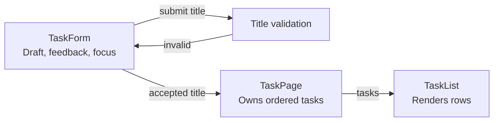

# Design with Mermaid

Put one Mermaid diagram first, after the revision and links. Pick the view that answers the main implementation or review question. Add a second view if it answers a different question that matters.

| Question | Mermaid view |
| --- | --- |
| Who owns behavior and state? What data crosses boundaries? | `flowchart` with component or data flow labels |
| What happens in order, including failures or retries? | `sequenceDiagram` |
| What events change the state? | `stateDiagram-v2` |
| How do domain types or persisted records relate? | `classDiagram` or `erDiagram` |

Use names from the code or proposal and label the arrows with actions or data. Use short bullets for decisions, constraints, and impacts the diagram cannot show. A doc-only or maintenance change without technical design can record why a diagram would add nothing. Link the wider architecture when relevant and verify the Mermaid renders in the review surface or a local preview.

## Example for a task creation feature

- The page owns the collection. The form owns the transient input and uses the title rule.
- Keep one page-level interaction test for submitting a title and seeing the task. Test title boundaries at the rule if it has an independent contract.
- Extract the list when it owns presentation or behavior worth naming. A simple list can stay inline.

[GitHub Mermaid support](https://docs.github.com/en/get-started/writing-on-github/working-with-advanced-formatting/creating-diagrams) · [Mermaid syntax](https://mermaid.js.org/intro/syntax-reference.html)
