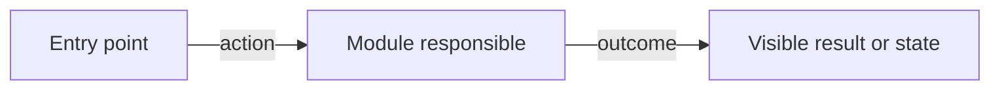

# Feature architecture

<!-- Link the requirements revision, architecture revision, and matching test specification. -->

## Proposed design

<!-- Start with a Mermaid diagram showing the primary flow or ownership. Label important actions, outcomes, and boundaries. Remove the placeholder and use the diagram type that fits. -->

- **Responsibilities** <!-- Name the modules, their public interfaces, and the owner of each important state or rule. -->
- **Behavior** <!-- Note invariants, errors, and recovery the diagram does not explain. -->
- **Decisions** <!-- Give short reasons for choices that affect implementation or verification. Link any ADR. -->

## Application-wide impact

- <!-- Note changes to shared contracts, data, infrastructure or compatibility. Link the affected shared architecture. -->

## Implementation order

1. <!-- List verifiable steps with dependencies and a link to the test sequence. -->
